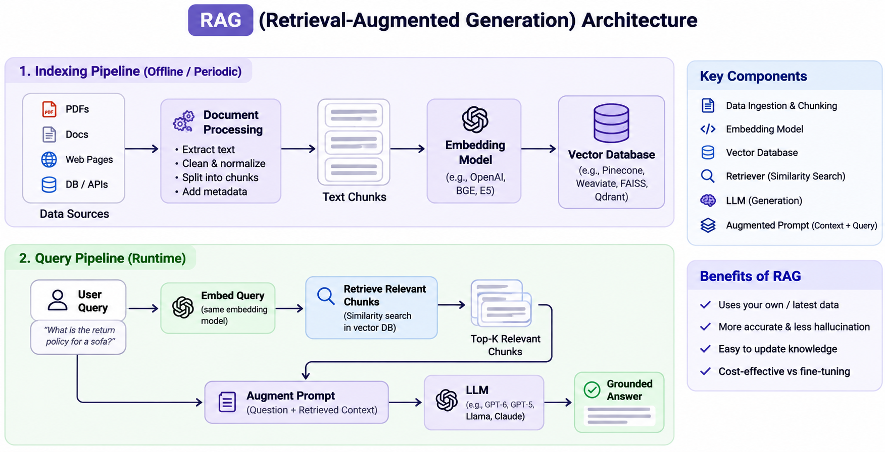

# RAG (Retrieval-Augmented Generation)

## What is RAG?

-   RAG stands for **Retrieval-Augmented Generation**.
-   It is a technique that helps an LLM answer questions using relevant
    information retrieved from an external knowledge source.
-   Instead of relying only on the information learned during training,
    the LLM receives useful context at query time.
-   RAG is commonly used to build chatbots and question-answering
    systems over private or domain-specific data.

## RAG Architecture



## Main Components

-   **Data Sources** -\> Documents, PDFs, web pages, databases, or APIs
    that contain the knowledge.
-   **Document Processing** -\> Extracts text, cleans it, and prepares
    it for indexing.
-   **Chunking** -\> Splits large documents into smaller, manageable
    text sections.
-   **Embedding Model** -\> Converts each text chunk into a numerical
    vector that represents its meaning.
-   **Vector Database** -\> Stores embeddings, along with their text and
    metadata, for efficient similarity search.
-   **Retriever** -\> Finds the chunks most relevant to a user's
    question.
-   **Prompt Builder** -\> Combines the user's question with the
    retrieved context.
-   **LLM** -\> Uses the augmented prompt to generate the final answer.

## 1. Indexing Pipeline (Offline)

-   **Step 1** -\> Collect data from PDFs, documents, websites,
    databases, or APIs.
-   **Step 2** -\> Extract and clean the text.
-   **Step 3** -\> Split the text into smaller chunks.
-   **Step 4** -\> Generate embeddings for each chunk using an embedding
    model.
-   **Step 5** -\> Store the embeddings, original text, and metadata in
    a vector database.

## 2. Query Pipeline (Runtime)

-   **Step 1** -\> The user submits a question.
-   **Step 2** -\> Convert the question into an embedding using the same
    compatible embedding model.
-   **Step 3** -\> Search the vector database for semantically similar
    chunks.
-   **Step 4** -\> Retrieve the most relevant chunks (Top-K results).
-   **Step 5** -\> Combine the user's question and retrieved chunks into
    an augmented prompt.
-   **Step 6** -\> Send the prompt to the LLM.
-   **Step 7** -\> Return the generated answer, grounded in the
    retrieved context.

## Why Use RAG?

-   It lets an LLM use your own or more recently updated data.
-   It can improve answer relevance and reduce unsupported answers when
    retrieval is effective.
-   You can update the knowledge base by re-indexing documents instead
    of retraining the LLM.
-   It is useful for private or domain-specific knowledge bases.
-   It is often a practical alternative to fine-tuning when the goal is
    to provide an LLM with external knowledge.

## Quick Summary

-   **Indexing** -\> Documents are processed, split into chunks,
    embedded, and stored.
-   **Retrieval** -\> A user's question is embedded and used to find
    relevant chunks.
-   **Generation** -\> The retrieved context and question are sent to
    the LLM to generate an answer.

> **Key idea:** RAG does not retrain the LLM. It retrieves relevant
> external information and supplies it as context when the model
> generates a response.

## Folder Structure

Keep the README and architecture image in the same folder:

``` text
rag-project/
├── README.md
└── rag-architecture.png
```
